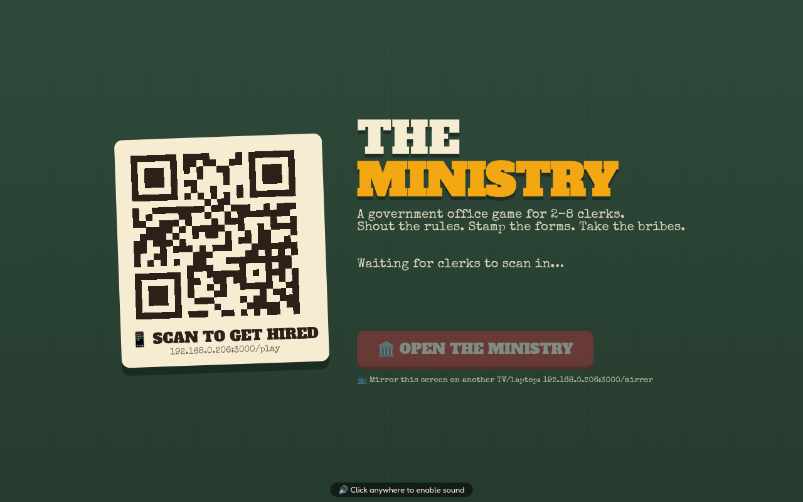

# The Ministry

A party game for 2–8 players set in an absurd government permit office. One screen is the
TV; everyone else plays on their phone by scanning a QR code. No app, no accounts.



Citizens line up with ridiculous requests ("marry a lighthouse", "keep a small dragon in a
rented apartment"). You're a clerk, and your phone holds **secret rules** nobody else can
see: which forms you must deny, which you must always approve, and who is even allowed to
stamp what. Forms pass from phone to phone, so you'll have to shout your rules across the
room and hope your colleagues listen.

Every stamp plays out live on the TV. Approve the wrong permit and the city pays for it:
*DRAGON IN APT 4B TORCHES BAKERY, ASKS FOR CROISSANT.* Clerks earn their own money, spend
it in the break-room shop, take bribes, and on Friday the office votes on who's been
corrupt.

## Play

**Play now:** open **https://the-ministry-game.fly.dev** on a TV or laptop and scan the QR code
with your phones. Every screen gets its own room code, so there's nothing to install.

## Run it yourself

Needs [Node.js](https://nodejs.org) 18 or newer.

```bash
git clone https://github.com/neilyneilynig/ministry.git
cd ministry
npm install
npm start
```

Open `http://localhost:3000/` on the computer hooked up to the TV, then have everyone scan
the QR code with a phone on the same Wi-Fi. Each TV screen gets its own 4-letter room code. A game takes about 30 minutes.

- `/mirror` shows the TV screen on a second display or laptop.
- `PORT=4000 npm start` changes the port.
- `PUBLIC_URL=https://example.com npm start` sets the address phones are sent to when you host it online.
- `DAY_SECS=60 npm start` makes each in-game day shorter (default 150 seconds).

If phones can't connect, check they're on the same network (not a guest network) and that
your firewall allows the port.
